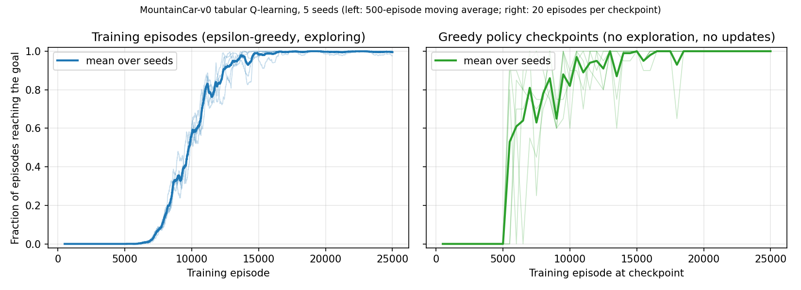

# MountainCar Q-learning

[](https://github.com/Yuv4n/mountaincar-q-learning-study/actions/workflows/tests.yml)

Tabular Q-learning (no neural network) that learns to solve Gymnasium's `MountainCar-v0`. The project is a tested, reproducible experiment with held-out evaluation, baselines and a small hyperparameter study.

## Headline results (measured)

| | Goal reached | Mean return |
|---|---|---|
| **Q-learning agent** (5 training seeds, 200 held-out episodes each) | **99.2% ± 1.8%** | **-126.2 ± 6.5** |
| Random policy | 0% | -200.0 |
| Hand-coded velocity rule (no learning) | 100% | -119.5 |

- **Evaluation:** frozen greedy policies on environment seeds 10000–10199, never used for training or tuning. Std is across training seeds. Raw numbers: [results/final/results.json](results/final/results.json).
- **Honest reading:** the agent clearly learns the rocking strategy, but is about 7 steps slower than the simple hand-coded rule. It does not beat that baseline.



*Right panel: greedy success on separate seeds every 500 episodes. The first successes appear around episode 5,500, and by about episode 18,500 every seed succeeds on every checkpoint.*

## Approach

- **Clean separation of concerns:** discretisation, action selection, the Q-update, training and evaluation are separate functions with 20 unit tests, run in CI on Python 3.9 and 3.12.
- **Held-out evaluation:** training, tuning and final evaluation use disjoint seeds, and the Q-table is frozen during evaluation.
- **Light hyperparameter study:** 8 settings, 3 validation seeds, with the selection rule fixed in advance. See [docs/tuning.md](docs/tuning.md).
- **Results with uncertainty:** 95% Wilson intervals per seed, mean ± std across seeds, and baselines run on identical evaluation seeds.
- **Reproducible:** pinned dependencies, saved configs and Q-tables, and identical results across Python 3.9 and 3.12.

## How it works

```
 observation (position, velocity)
        │  discretise: 40 × 40 bins, indices clipped to the grid
        ▼
 Q-table [40 × 40 × 3 actions]  ──►  epsilon-greedy action (ε: 1 → 0 over first half)
        ▲                                   │
        │   Q(s,a) ← (1−α)Q(s,a) + α(r + γ·max Q(s′,·))
        └────────────  reward, next state ◄─┘  MountainCar-v0
```

Settings: α = 0.2, γ = 0.99, 25,000 episodes. One detail worth noting: reaching the flag (`terminated`) ends the update with no future term, while the 200-step limit (`truncated`) still bootstraps from the next state.

## Run it

```sh
python3 -m venv .venv && source .venv/bin/activate
pip install -r requirements.txt
python -m pytest                                          # 20 tests
python train.py --seed 0 --out runs/seed0                 # train one agent (~75 s), compare with random
python experiment.py --config configs/final.json --out results/final   # full 5-seed experiment
```

`train.py --render-every N` opens a window every N episodes. The pinned versions were tested on Python 3.9.6 and 3.12 on macOS.

## Repository map

| Path | Purpose |
|---|---|
| `qlearning.py` | Discretisation, epsilon-greedy, Q-update, training, evaluation |
| `train.py` / `experiment.py` | Single run / multi-seed experiment with plots |
| `tests/` | Unit tests: bin boundaries, action selection, terminal vs truncated updates, frozen evaluation |
| `configs/`, `results/` | Experiment configs and saved outputs, including Q-tables |
| `docs/` | Tuning study and supporting notes |
| `legacy/` | Earlier 2021 version of the script, kept for reference |

## Limits

- One small discrete-grid method on one environment; five training seeds.
- Tuning was light (three seeds), so the chosen setting is not shown to be clearly better than the alternatives.
- The learned policy matches but does not beat a simple hand-coded baseline.

MIT licence.
